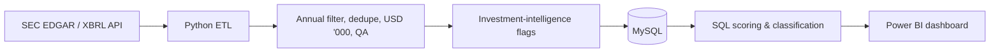

# Corporate-Venture-Investment-Intelligence-Target-Selection

A data-driven screening workflow that turns public SEC filings into a ranked shortlist of companies for further human due diligence. It runs from SEC EDGAR/XBRL extraction in Python, through MySQL and SQL scoring, to a three-page Power BI dashboard.

> **Decision support, not investment advice.** The score is a financial-direction screen. It does not include valuation, market size, competition, strategic fit or management quality.

## The business problem

Corporate venture and strategic investment teams often have more public companies to look at than they have due-diligence hours. This project consolidates public financial data, measures how each company's performance is moving, flags warning signs, and prioritises companies for a closer human review.

## Pipeline



## Companies and period

Etsy (ETSY), Shake Shack (SHAK), Crocs (CROX), Boot Barn (BOOT), Duolingo (DUOL) · FY2023–FY2025.

## How the screening works

Each company is checked on five directional signals: revenue growth, operating margin, net margin, cash generation and operating income. **Net score = positive signals − negative signals.**

| Company | Positive | Negative | Net score | Classification |
| --- | --- | --- | --- | --- |
| DUOL | 5 | 0 | +5 | Strong Candidate |
| SHAK | 5 | 0 | +5 | Strong Candidate |
| BOOT | 3 | 2 | +1 | Watchlist |
| ETSY | 1 | 4 | −3 | Weak Candidate |
| CROX | 0 | 5 | −5 | Weak Candidate |

"Weak" means weak under these screening rules. It is not a verdict on the business.

## Dashboard (Power BI)

Three pages, with green, amber and red meaning Strong, Watchlist and Weak throughout:

1. **Executive Overview**: KPI cards, net-score chart, candidate ranking table, short reading of the result.
2. **Performance Comparison**: five-button metric switcher driving a company comparison chart and a year-by-year trend line, plus a full comparison table.
3. **Company Detail**: company slicer, KPI cards, revenue by year and margins by year.


## Tech stack

Python (requests, pandas, SQLAlchemy, PyMySQL) · Jupyter Notebook · SEC EDGAR Company Facts API · MySQL / MySQL Workbench · Power BI Desktop (DAX measures, calculated columns and tables).

## Key design decisions

- **Reusable ETL** built after a manual Etsy prototype, so the extraction and QA pattern was understood before automating it.
- **Annual-period selection** handles repeated comparative values in later filings, rather than trusting `fy` alone.
- **Missing data stays missing.** Shake Shack gross profit and Crocs operating cash flow are NULL, shown as blank in the dashboard, never as zero.
- **Simple over clever in Power BI.** A small `Metric Options` table plus one `SWITCH` measure replaced a field parameter that returned a blank chart.
- **Prototype first.** Three layouts were tested as HTML mockups, and the simplest was built.

## Problems solved along the way

| Problem | Fix |
| --- | --- |
| Boot Barn SEC 404 | Corrected the CIK and validated identifiers before automating |
| pandas `to_sql` failed with a raw PyMySQL connection | Used a SQLAlchemy engine |
| Power BI could not find the table | Used the full imported name (schema + table) |
| No classification column in MySQL | Created Net Score and Classification in DAX |
| Ranking ties gave BOOT rank 1 | Rewrote Rank as companies with a higher score + 1 |
| MySQL import wizard loaded 6 of 15 rows | Replaced with an explicit SQL INSERT script |
| Detail page ignored the slicer | Related `financial_data[ticker]` to the screening table's `company` |
| Trend chart showed one line titled "%GT" | Removed "percent of grand total" and used `ticker` as the legend |

The full error and resolution log is in the project documentation.

## Repository structure (adjust to your repo)

```
├── notebooks/            # Jupyter notebook: extraction, ETL, QA, screening
├── sql/                  # table creation, load script, analysis queries
├── powerbi/              # .pbix file and CVI_Dark_Theme.json
├── docs/                 # project documentation (Word) and images/
└── README.md
```

## Running it

1. Run the notebook to extract SEC data, transform it and build the screening dataset.
2. Create the MySQL database `investment_intelligence` and load `investment_screening` and `financial_data` (scripts in `sql/`).
3. Open the Power BI file, point it at your MySQL server, and refresh.

**Keep credentials out of the repo.** Store the database password in an environment variable or a `.env` file listed in `.gitignore`, and URL-encode special characters in connection strings.

## Limitations

- Financial-first screen: no valuation, market size, competition, strategic fit or management quality.
- Five companies and three fiscal years: the results illustrate the method and are not a market-wide screen.
- Year-on-year growth starts in FY2024 because FY2022 is not in the dataset.
- The classification rule currently lives in a Power BI calculated column. Moving it into a MySQL view would give SQL and Power BI one definition.
- Two diagnostics are flagged for review: the Crocs earnings-vs-cash-flow flag, and the Crocs growth signal, which counts as negative although FY2023–FY2025 growth is +1.98%.

## Future work

Valuation and market-size data, competitive and strategic-fit analysis, a larger company universe, the classification rule in MySQL, and publishing to Power BI Service with scheduled refresh.

## Data source

SEC EDGAR Company Facts XBRL API (data.sec.gov). XBRL data is the extraction layer; official filings remain the authoritative source for reconciliation.

---

*Built as a portfolio project. Feedback and questions are welcome.*
